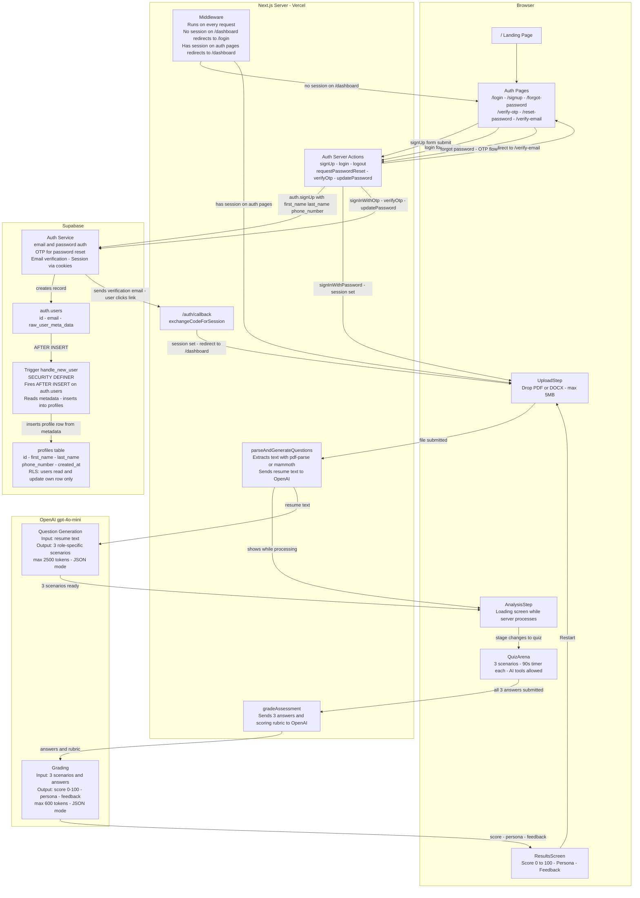

# AI Fluency Test

AI Fluency Test is a role-specific assessment that evaluates how effectively a person uses judgment, critical thinking, and structured reasoning while working with AI tools.

Instead of testing theoretical AI knowledge, it presents realistic workplace scenarios based on the candidate’s resume.

## What It Does

1. The candidate uploads a PDF or DOCX resume.
2. AI analyzes the candidate’s role, experience, and domain.
3. Three personalized workplace scenarios are generated.
4. The candidate completes each scenario within a time limit.
5. AI evaluates the responses and provides:
   - An overall score
   - An AI-fluency persona
   - Personalized feedback

Candidates may use tools such as ChatGPT, Claude, or Gemini during the assessment.

## Assessment Approach

The assessment uses three types of scenarios:

- **Flawed premise:** Tests whether the candidate notices and challenges an incorrect assumption.
- **Judgment gap:** Tests decision-making where there is no single perfect answer.
- **Forced decomposition:** Tests whether a complex task is broken into clear, manageable parts.

The grading process prioritizes critical thinking and domain judgment over polished AI-generated writing.

## Key Features

- resume-based question generation
- Role-specific workplace scenarios
- PDF and DOCX support
- Timed assessment questions
- AI-assisted grading
- Personalized feedback and personas
- Email/password and Google authentication
- Responsive desktop and mobile interface

## Technology Stack

- **Framework:** Next.js 14
- **Language:** TypeScript
- **UI:** React and Tailwind CSS
- **Authentication:** Supabase Auth
- **Database:** Supabase PostgreSQL
- **AI:** OpenAI API
- **Document parsing:** `pdf-parse` and `mammoth`
- **Form validation:** React Hook Form and Zod
- **Animations:** Framer Motion

## Getting Started

### Prerequisites

- Node.js 20 or later
- A Supabase project
- An OpenAI API key

### Installation

```bash
git clone https://github.com/shanthan5589/ai-fluency-test.git
cd ai-fluency-test
npm install
```

Create a `.env.local` file:

```env
NEXT_PUBLIC_SUPABASE_URL=
NEXT_PUBLIC_SUPABASE_ANON_KEY=
NEXT_PUBLIC_SITE_URL=http://localhost:3000
OPENAI_API_KEY=
```

Apply the SQL migrations located in:

```text
supabase/migrations/
```

Start the development server:

```bash
npm run dev
```

Open `http://localhost:3000` in your browser.

## Available Commands

Start the development server:

```bash
npm run dev
```

Create and validate a production build:

```bash
npm run build
```

Run the production build:

```bash
npm run start
```

Check the project for linting problems:

```bash
npm run lint
```

## Data and Privacy

Assessment questions, answers, and scores are not currently written to the application database. They remain in temporary application state during the assessment.

Resume text and assessment responses are sent to the OpenAI API for processing. User account and profile information is managed through Supabase.

## Current Limitations

This project is currently an MVP.

- Assessment results are not saved between sessions.
- Refreshing the page resets an active assessment.
- Timing is managed in the browser.
- AI-generated questions and scores may vary between attempts.
- The assessment should not be used as the sole basis for employment decisions.

## Future Improvements

- Save assessment history
- Provide detailed question-by-question reports
- Add an integrated AI workspace
- Record AI interaction and iteration history
- Add organization and recruiter dashboards
- Export or share assessment reports
- Improve scoring consistency using benchmark datasets

## Project Structure

```text
src/
├── actions/            # Authentication and assessment server actions
├── app/                # Next.js routes and layouts
├── components/
│   ├── assessment/     # Assessment flow and results
│   ├── auth/           # Authentication forms
│   ├── landing/        # Landing page
│   └── ui/             # Reusable UI components
└── lib/
    └── supabase/       # Supabase clients and middleware

supabase/
└── migrations/         # Database schema and profile trigger
```

## Disclaimer

AI-generated scoring is intended to provide directional feedback. It should be reviewed alongside other evaluation methods when used in recruitment, education, or professional development.

---

## Architecture



## License

This project is licensed under the MIT License. See the [LICENSE](LICENSE) file for details.